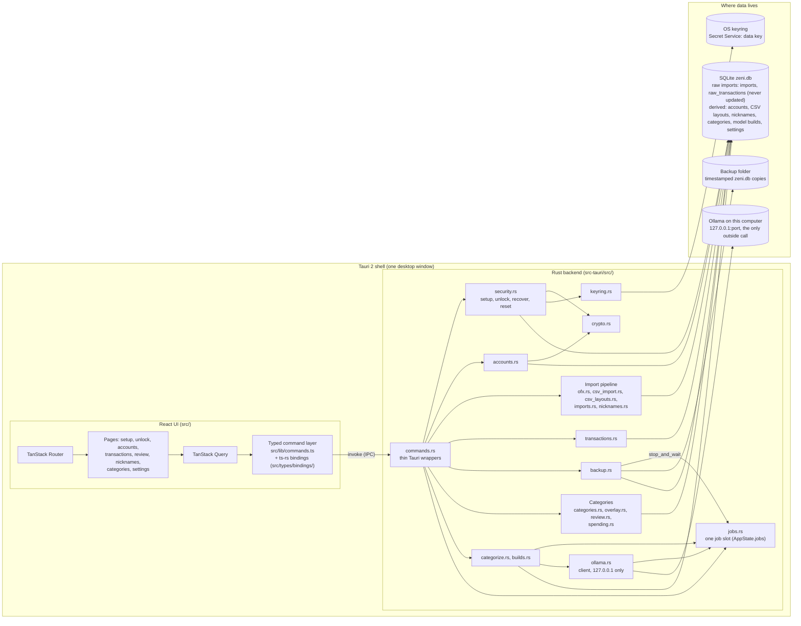
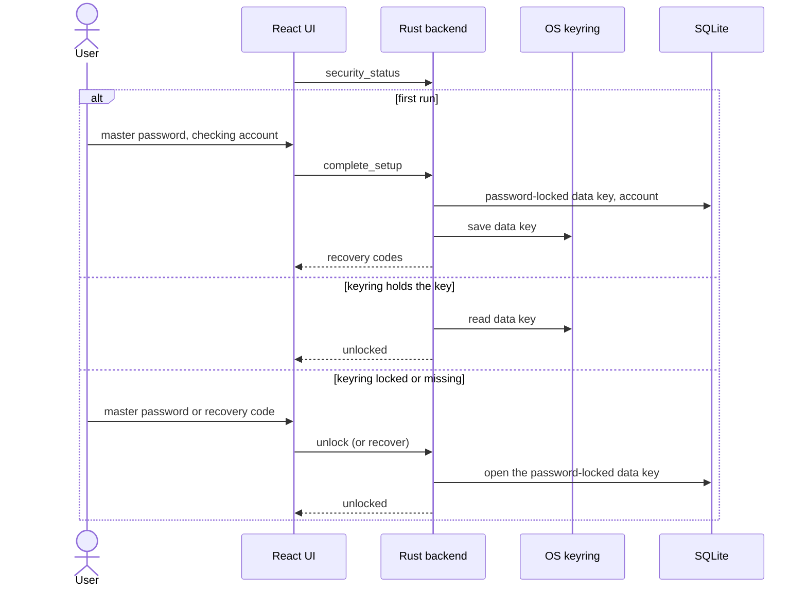
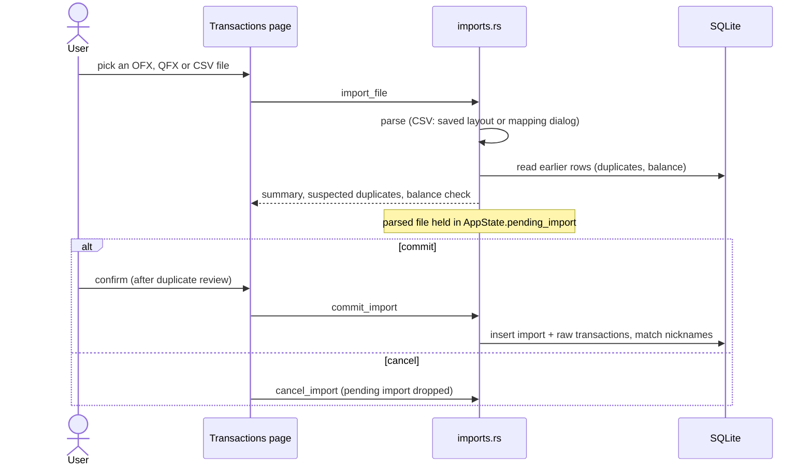
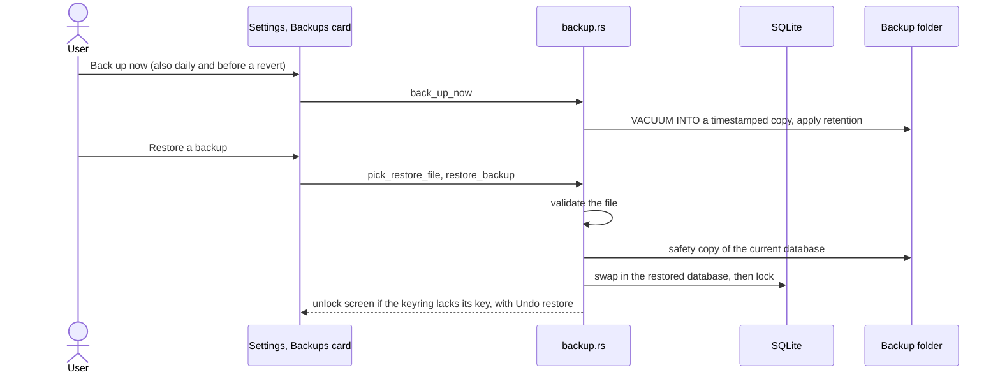
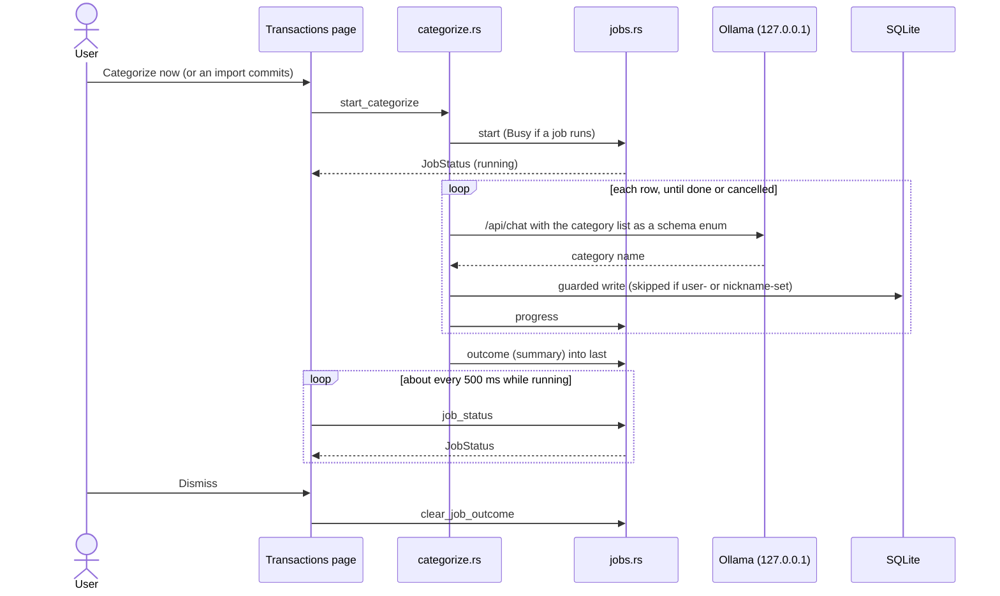

# Architecture

How Zeni's parts fit together, at a glance. Security details: [security.md](security.md). Schema: [database.md](database.md).

## Components and data

## Main flows

### Setup and unlock

### Import: preview, then commit

### Backup and restore

### Categorize

The UI polls `job_status`; there are no Tauri events. One job runs at a time. Why: [ADR 0001](adr/0001-derived-effective-category-and-polled-job-slot.md). Guide: [categories.md](categories.md).

The `effective_categories` view gives every reader the same answer: user, else nickname default, else model.
