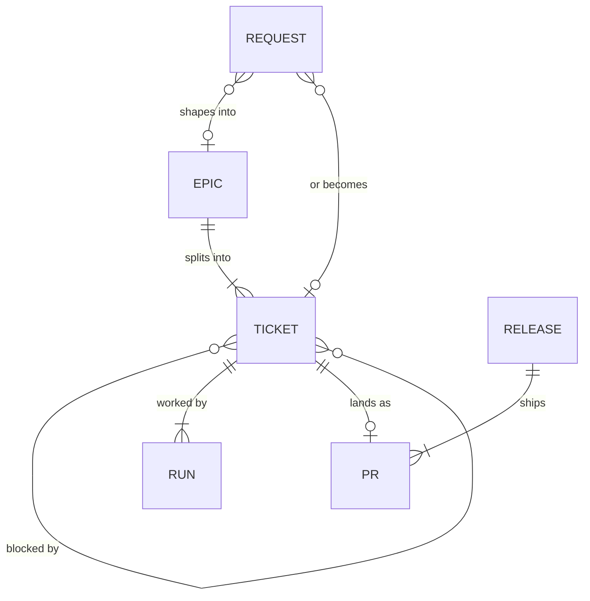
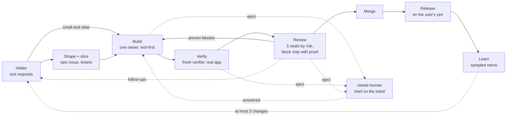
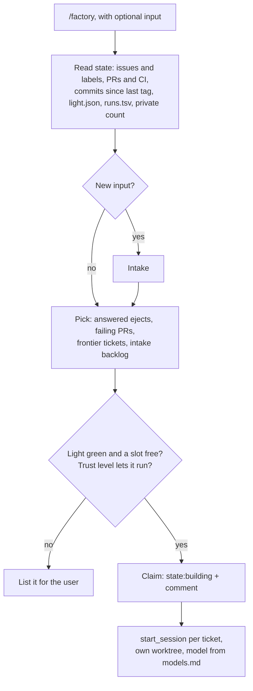
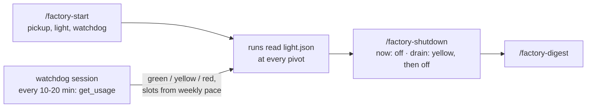
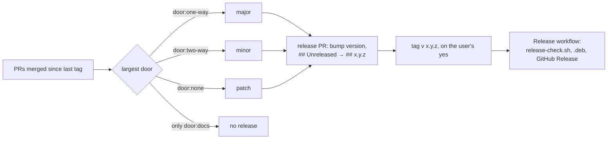

# Factory workflow

How Zeni's Claude Code factory (`.claude/`) turns a request into a release. The rules live in `.claude/factory/spine.md` and the station guides; this page is the map.

## Units

The issue number ties them together: branch `t<issue>-<words>`, `Closes #<n>`, ticket comments, the changelog bullet. An epic is not a release.

## Stations

Each ticket carries one `state:` label: `intake`, `shaping`, `ready`, `building`, `verifying`, `reviewing`, `merged`, `released`, `needs-human`.

## Dispatch

## Factory run and the traffic light

The 5-hour window sets the light (green under 70%, yellow 70-89%, red 90%+). The weekly window is paced into 3, 2, 1 or 0 slots and turns the light red at 97%. A light older than 45 minutes counts as yellow.

## Release

## Checks

`scripts/check.sh` tiers: `fast` (policy greps from `CONSTRAINTS.md`, type-check, fmt, clippy), `task` (fast plus named tests), `integration` (full suites, bindings freshness, optional evidence manifest) and `fresh`. CI runs `integration` and both self-tests; the `Door` workflow checks each PR's label.
