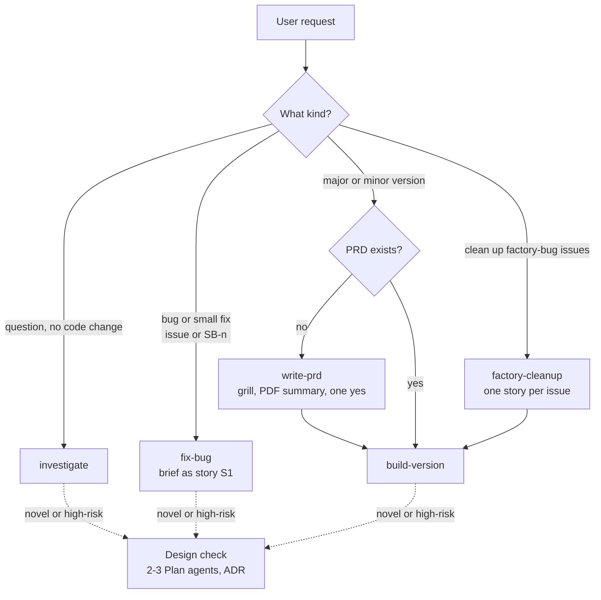
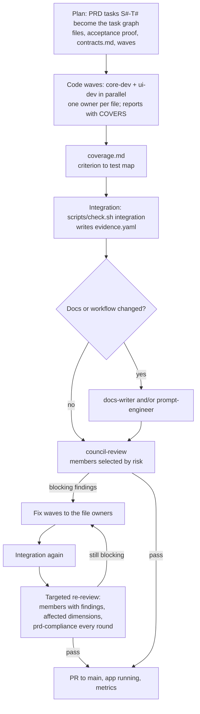
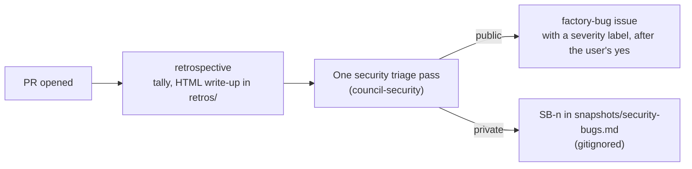

# Factory workflow

How Zeni's Claude Code agents and skills (`.claude/`) turn a request into a pull request. The rules live in the skills; this page is the map.

## Routing

## build-version

`scripts/check.sh` tiers: `fast` (policy, type-check, fmt, clippy), `task` (fast plus named tests, run by each dev), `integration` (full suites, bindings freshness, evidence manifest) and `fresh` (whether the manifest still matches the tree).

## After a PR

Blocking findings, earlier rounds' failures and every `council-security` finding stay private, whatever the triage says (`build-version` step 6.2). Process ideas stay retrospective recommendations and are never filed.
